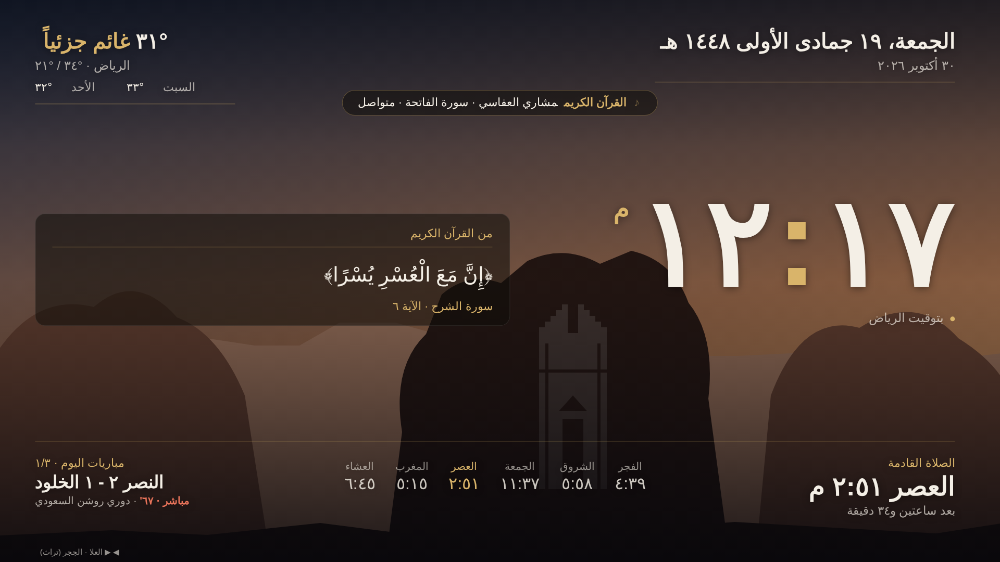
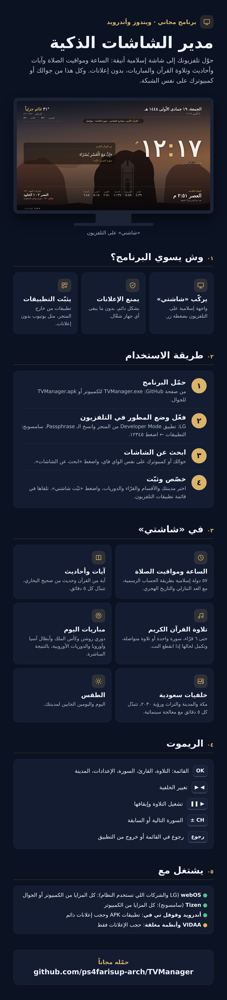
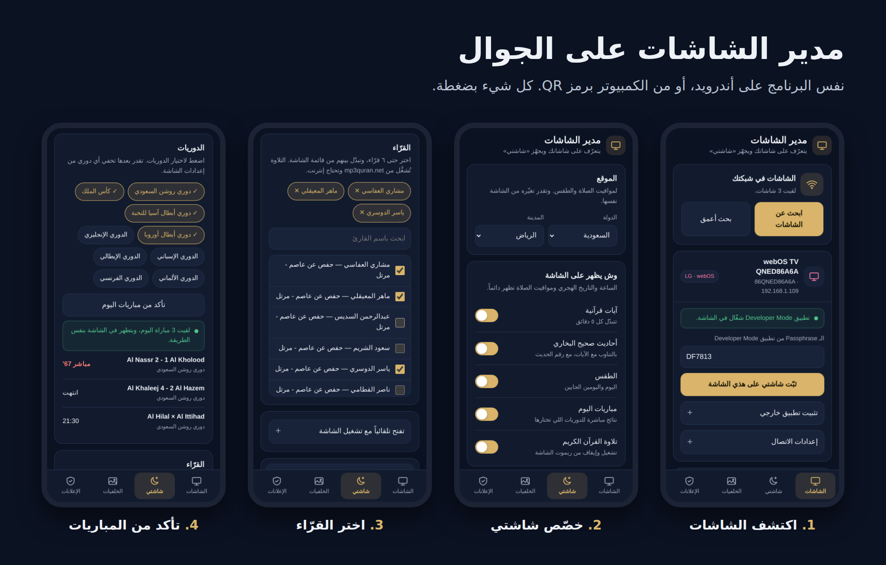
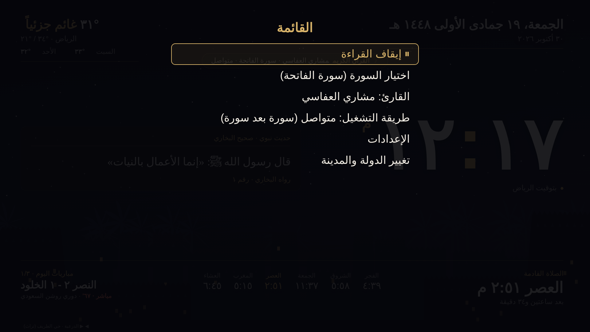
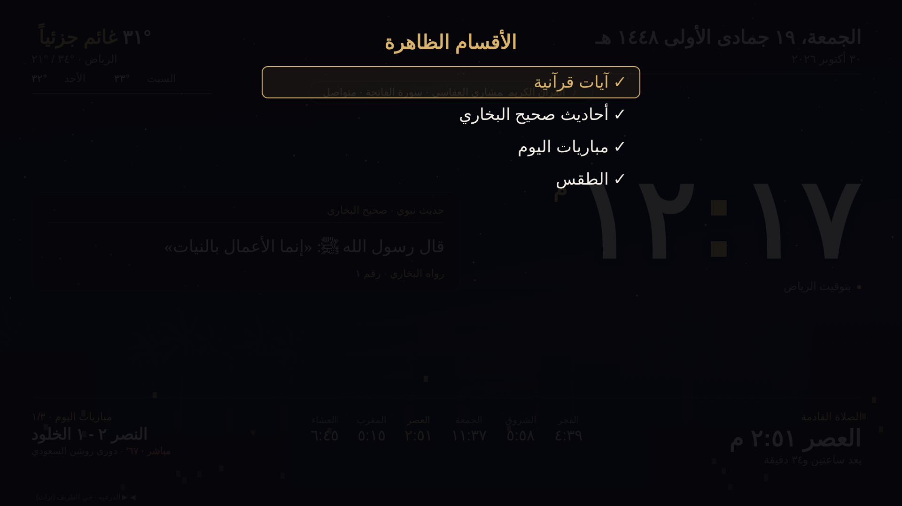
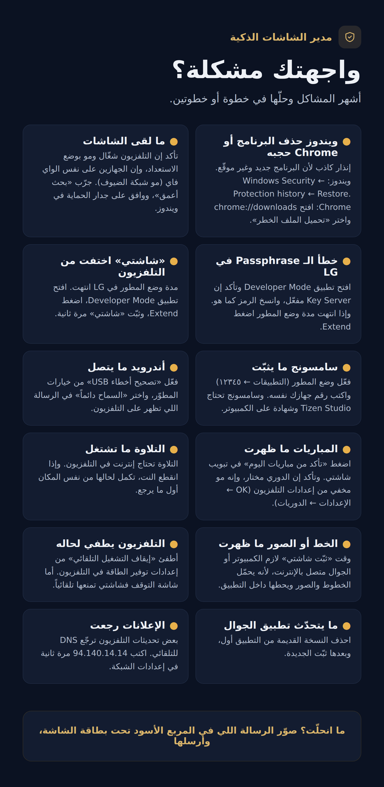

<div dir="rtl">

# مدير الشاشات الذكية

برنامج مجاني يحوّل تلفزيونك إلى شاشة إسلامية أنيقة باسم **«شاشتي»**: الساعة ومواقيت الصلاة والتاريخ الهجري، وآيات وأحاديث، وتلاوة القرآن الكريم، ومباريات اليوم، والطقس، وخلفيات من مكة والمدينة والتراث السعودي ورؤية ٢٠٣٠. ويمنع إعلانات التلفزيون، ويثبّت تطبيقات من خارج المتجر. كل هذا من جوالك أو كمبيوترك على نفس الشبكة.



## التحميل

حمّل آخر نسخة من صفحة [الإصدارات](https://github.com/ps4farisup-arch/TVManager/releases/latest):

| الملف | الجهاز |
| --- | --- |
| `TVManager.exe` | كمبيوتر ويندوز |
| `TVManager.apk` | جوال أندرويد (يشتغل لحاله بدون كمبيوتر) |

> **أول تشغيل على ويندوز:** إذا ظهرت رسالة «Windows protected your PC» اضغط **More info** ثم **Run anyway**، ووافق على صلاحية المسؤول وجدار الحماية.
> **على الأندرويد:** اسمح بالتثبيت من مصادر غير معروفة، وإذا ظهر تنبيه Play Protect اختر «التثبيت على أي حال».
> **الآيفون:** افتح البرنامج على الكمبيوتر، واضغط زر «الجوال» فوق، وصوّر رمز QR بالكاميرا. تنفتح اللوحة في سفاري.

## يشتغل مع أي تلفزيونات؟

| نظام التلفزيون | أمثلة | المتاح |
| --- | --- | --- |
| webOS | LG وأي شركة تستخدم النظام | كل المزايا، من الكمبيوتر أو الجوال |
| Tizen | سامسونج وأي شركة تستخدم النظام | كل المزايا، من الكمبيوتر فقط |
| أندرويد وقوقل تي في | TCL، سوني، شاومي، شارب، وغيرها | تطبيقات APK وحجب إعلانات دائم |
| أنظمة مغلقة | VIDAA في أغلب هايسنس، وغيرها | حجب الإعلانات فقط |

تعرف نظام تلفزيونك من: الإعدادات ← عام ← حول التلفزيون.

## طريقة الاستخدام



### ١. جهّز التلفزيون (مرة وحدة)

**LG وشاشات webOS**
1. من متجر التطبيقات في التلفزيون ثبّت تطبيق **Developer Mode**.
2. سجّل دخول بحساب مطور LG، وهو مجاني من موقع `webostv.developer.lge.com`.
3. فعّل **Dev Mode Status** و **Key Server**، والتلفزيون بيعيد التشغيل.
4. خلّ التطبيق مفتوح، وبتحتاج الرمز المكتوب جنب **Passphrase**.

**سامسونج وشاشات Tizen** (من الكمبيوتر فقط)
1. افتح «التطبيقات» في التلفزيون، واضغط بالريموت **12345**.
2. فعّل Developer Mode، واكتب رقم IP الكمبيوتر (يظهر في البرنامج).
3. أطفئ التلفزيون وشغّله.
4. ثبّت Tizen Studio على الكمبيوتر، وأنشئ شهادة سامسونج من Certificate Manager.

**أندرويد وقوقل تي في**
1. الإعدادات ← تفضيلات الجهاز ← حول ← اضغط على «البنية» ٧ مرات.
2. من «خيارات المطوّر» فعّل **تصحيح أخطاء USB**.
3. أول اتصال تطلع رسالة على التلفزيون، اختر **السماح دائماً**.

### ٢. ابحث عن التلفزيون

افتح البرنامج والجهاز على **نفس شبكة الواي فاي** اللي عليها التلفزيون، واضغط **«ابحث عن الشاشات»**. إذا ما ظهر، جرّب **«بحث أعمق»**.

### ٣. خصّص «شاشتي»

من تبويب **شاشتي** في البرنامج:
- اختر **الدولة والمدينة** لمواقيت الصلاة والطقس.
- شغّل أو أطفئ الأقسام: الآيات، والأحاديث، والطقس، والمباريات، والتلاوة.
- اختر **الدوريات**، واضغط **«تأكد من مباريات اليوم»** عشان تشوف إنها تشتغل.
- اختر حتى **٦ قرّاء**.
- اضغط **«معاينة»** عشان تشوف الشكل على الكمبيوتر قبل التثبيت.



### ٤. ثبّت

في LG اكتب الـ Passphrase في بطاقة التلفزيون، واضغط **«ثبّت شاشتي»**. تلقاها بعدها في قائمة تطبيقات التلفزيون.

> تأكد إن جهازك متصل بالإنترنت وقت التثبيت، لأن البرنامج يحمّل الخطوط والصور ويحطها داخل التطبيق.

## استخدام «شاشتي» بالريموت

| الزر | الوظيفة |
| --- | --- |
| **OK** | القائمة: تشغيل التلاوة وإيقافها، اختيار السورة، القارئ، طريقة التشغيل، الإعدادات، المدينة |
| **◀ ▶** | تغيير الخلفية |
| **تشغيل / إيقاف** | تشغيل التلاوة أو إيقافها مباشرة |
| **CH + / CH −** | السورة التالية أو السابقة |
| **رجوع** | رجوع في القائمة، أو خروج من التطبيق |



### الإعدادات على التلفزيون نفسه

**OK ← الإعدادات**، وفيها:
- **الأقسام الظاهرة:** إخفاء أو إظهار الآيات، والأحاديث، والمباريات، والطقس.
- **الخلفيات:** اضغط على أي صورة عشان تخفيها من التبديل.
- **الدوريات:** إخفاء أي دوري من الشاشة.

التلفزيون يحفظ إعداداتك حتى لو قفلت التطبيق.



## منع الإعلانات

**الطريقة الدائمة** (بدون كمبيوتر ولا جوال): غيّر خادم DNS في إعدادات الشبكة بالتلفزيون إلى خادم AdGuard المجاني:

```
94.140.14.14
94.140.15.15
```

- **سامسونج:** الإعدادات ← عام ← الشبكة ← حالة الشبكة ← إعدادات IP ← إعداد DNS ← إدخال يدوي.
- **LG:** الإعدادات ← عام ← الشبكة ← اختر الاتصال ← الإعدادات المتقدمة ← تعديل ← ألغِ «تلقائي» عند DNS.
- **أندرويد وقوقل تي في:** من بطاقة التلفزيون في البرنامج، اضغط **«فعّل حجب الإعلانات»**. أو يدوياً: الإعدادات ← الشبكة ← DNS الخاص ← `dns.adguard-dns.com`
- **كل أجهزة البيت:** حط الرقمين في إعدادات DNS داخل المودم.

## حل المشاكل



<details>
<summary><b>ويندوز حذف البرنامج، أو Chrome حجب التحميل</b></summary>

إنذار كاذب، لأن البرنامج جديد وغير موقّع بشهادة مدفوعة.
- **ويندوز:** Windows Security ← Virus & threat protection ← Protection history ← اختر التنبيه ← Restore. وعشان ما يتكرر، أضف مجلد البرنامج في Exclusions.
- **Chrome:** افتح `chrome://downloads` واختر «Download dangerous file»، أو حمّل الملف من Edge.

</details>

<details>
<summary><b>البرنامج ما لقى التلفزيون</b></summary>

- تأكد إن التلفزيون شغّال، مو في وضع الاستعداد.
- تأكد إن الجهازين على نفس الشبكة، وإنها مو «شبكة الضيوف» في المودم.
- اضغط **«بحث أعمق»**.
- على ويندوز: وافق على جدار الحماية أول مرة تشغّل فيها البرنامج.

</details>

<details>
<summary><b>LG: رسالة إن الـ Passphrase غير صحيحة</b></summary>

- افتح تطبيق Developer Mode في التلفزيون، وتأكد إن **Key Server** مفعّل.
- انسخ الرمز كما هو بالضبط.
- إذا تغيّر الرمز بعد إعادة التشغيل، اكتب الجديد.

</details>

<details>
<summary><b>LG: «شاشتي» اختفت من التلفزيون</b></summary>

مدة وضع المطور انتهت. افتح تطبيق Developer Mode، واضغط **Extend**، وبعدها ثبّت «شاشتي» من البرنامج مرة ثانية.

</details>

<details>
<summary><b>سامسونج: التثبيت ما يشتغل</b></summary>

- تأكد إن وضع المطور مفعّل، ومربوط برقم IP الكمبيوتر نفسه. البرنامج ينبهك إذا كان مربوط بجهاز ثاني.
- سامسونج تشترط توقيع التطبيق بشهادتك. ثبّت Tizen Studio، وأنشئ الشهادة، واكتب اسمها في تبويب شاشتي ← شاشات سامسونج.

</details>

<details>
<summary><b>أندرويد: ما يتصل بالتلفزيون</b></summary>

- فعّل **تصحيح أخطاء USB** من خيارات المطوّر.
- اختر **السماح دائماً** في الرسالة اللي تظهر على التلفزيون خلال ٤٥ ثانية.
- من الجوال يكون الاتصال على المنفذ 5555. أما «الإقران برمز» فيشتغل من الكمبيوتر فقط.

</details>

<details>
<summary><b>المباريات ما ظهرت</b></summary>

- اضغط **«تأكد من مباريات اليوم»** في تبويب شاشتي. إذا ظهرت هناك، بتظهر في التلفزيون.
- تأكد إن الدوري مختار في البرنامج، وإنه مو مخفي من إعدادات التلفزيون (OK ← الإعدادات ← الدوريات).
- التلفزيون نفسه لازم يكون متصل بالإنترنت.

</details>

<details>
<summary><b>تلاوة القرآن ما تشتغل أو توقف</b></summary>

- التلاوة تُشغَّل مباشرة من الإنترنت، فلازم التلفزيون يكون متصل.
- إذا انقطع النت، التلاوة تكمل لحالها من نفس المكان أول ما يرجع الاتصال، وتظهر علامة … في الشريط فوق وقت المحاولة.
- إذا كنت على نسخة قديمة، حدّث البرنامج وثبّت «شاشتي» مرة ثانية.

</details>

<details>
<summary><b>الخط أو الصور ما ظهرت في التلفزيون</b></summary>

وقت «ثبّت شاشتي» لازم الكمبيوتر أو الجوال يكون متصل بالإنترنت. أعد التثبيت وأنت متصل.

</details>

<details>
<summary><b>التلفزيون يطفي لحاله</b></summary>

«شاشتي» تمنع شاشة التوقف تلقائياً. لكن خيار **إيقاف التشغيل التلقائي** في التلفزيون منفصل، ولازم تطفيه يدوياً من إعدادات توفير الطاقة. وإذا ما لقيته، اكتب في بحث الإعدادات: Auto Power Off.

</details>

<details>
<summary><b>تطبيق الأندرويد ما يتحدّث</b></summary>

احذف النسخة القديمة من جوالك أول، وبعدها ثبّت الجديدة.

</details>

<details>
<summary><b>الإعلانات رجعت</b></summary>

بعض تحديثات التلفزيون ترجّع إعداد DNS إلى «تلقائي». اكتب `94.140.14.14` مرة ثانية في إعدادات الشبكة.

</details>

## مصادر البيانات

مواقيت الصلاة والتاريخ الهجري: Aladhan · الطقس: Open-Meteo · الآيات: AlQuran Cloud · الأحاديث: نص صحيح البخاري من مشروع hadith-api المفتوح · التلاوات: mp3quran.net · المباريات: ESPN · الصور: Wikimedia Commons بتراخيص حرة، واسم المصوّر يظهر على الشاشة.

## تنبيه

البرنامج يستخدم وضع المطور الرسمي في التلفزيونات لتثبيت التطبيقات. استخدمه على أجهزتك أنت أو بإذن أصحابها.

</div>
